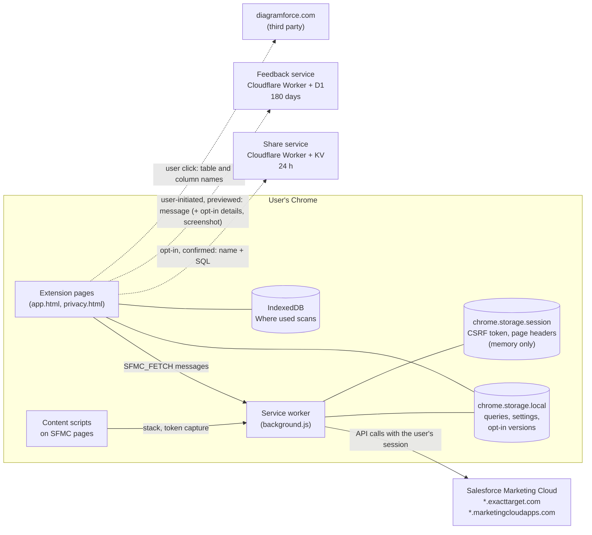

# Marketing Cloud Toolkit: security summary

For security and privacy reviewers. Describes version 2.0.18 (the first version after the October 2026 security review). The privacy policy is `PRIVACY.md`; how to report a problem is `SECURITY.md`.

## Purpose

A Chrome extension for people who work in Salesforce Marketing Cloud (SFMC). In one full-tab app it lets them write, save and run SQL queries, and browse their own account's automations, journeys, data extensions, CloudPages and emails. It works through the user's existing SFMC login in the same browser and calls SFMC's own APIs on the user's behalf. It has no server of its own for SFMC data: SFMC data goes only between the browser and SFMC.

Single purpose (as declared to the Chrome Web Store): help Marketing Cloud users work with their own account.

## Data flow

Solid lines happen as part of normal use. Dotted lines happen only when the user starts them, and Share needs a setting turned on first.

## Permissions

| Permission | Why it is needed | Code |
|---|---|---|
| `storage` | Saved queries, settings and opt-in saved versions in `chrome.storage.local`; CSRF token and Contact Builder headers in `chrome.storage.session` (memory only); admin policy in `chrome.storage.managed`. | throughout; `src/background/csrf.js`, `src/background/pageHeaders.js`, `src/utils/policy.js` |
| `cookies` | Reads the names and expiry of SFMC login cookies to tell which SFMC stack (s4, s7, ...) the user is on, and the value of Content Builder's `_csrf` double-submit cookie to send back with changes there (email revert, activity restore). Values are never stored or sent anywhere but SFMC. | `src/background/stack.js` (`scanCookieStacks`), `src/background/csrf.js` (`getAppCsrf`), `src/background/sessions.js` |
| `webRequest` | SFMC only issues its CSRF token as a header on its own requests; the extension reads it to make the user's own changes (run a query, create a data extension). Also: which stack a tab uses; Contact Builder's headers for the Contacts page (off under the `disableContacts` policy); and, only when the user turns them on, the bodies of Content Builder email saves, Automation Studio activity saves and Query Studio runs, to keep a copy. No blocking, no modification. | `src/background/index.js` (listener registrations), `csrf.js`, `stack.js`, `pageHeaders.js`, `capture.js`, `activityCapture.js` |
| `notifications` (optional) | Requested only when the user turns on desktop notifications for watched automations; given back when turned off. | `src/background/watches.js`, Settings |
| Host `https://*.exacttarget.com/*`, `https://*.marketingcloudapps.com/*`, `https://*.marketingcloud.com/*`, `https://*.salesforce-marketingcloud.com/*` | SFMC's own domains: API calls with the user's session (extension pages cannot send cookies, so the service worker makes the calls) and the content scripts below. | `src/background/fetchProxy.js` |
| Optional host `https://*.herokuapp.com/*` | Requested only when the user turns on Save Query Studio runs (Query Studio and Query Studio 2 are SFMC apps hosted on Heroku). Only `querystudio*.herokuapp.com/query/create` requests are read. Given back when turned off. | `src/utils/queryStudio.js`, `src/background/capture.js` |

Not used: `tabs` (removed in 2.0.18; tab URLs of SFMC pages are visible through the host permissions), `unlimitedStorage` (removed in 2.0.18), `scripting`, `activeTab`, `<all_urls>`, `externally_connectable`, `web_accessible_resources`.

### Content scripts

| Script | Where | What it does |
|---|---|---|
| `content.js` | SFMC domains | Reads the stack and REST endpoints from SFMC's single sign-on page (a hidden JWT the page already contains) and, in a background tab the extension opens, the access token SFMC's apps use. Sends them to the service worker; the token stays in its memory. |
| `automationPanel.js` | SFMC domains | The optional Automation Summary tab in Automation Studio (Settings switch). Reads one automation (GET) through the service worker. |
| `dashboardPanel.js` | SFMC domains | The optional summary card on SFMC's dashboard page (off by default). |
| `share-handler.js` | the share service's `/share/*` pages | Offers to import the shared query into Saved queries, on a real click only; nothing under the `disableShare` policy. |

The service worker accepts from content scripts only the messages those scripts use, and from the Automation Summary tab only a GET of one automation (`src/background/senders.js`). Web pages cannot message the extension.

### Content Security Policy

`script-src 'self'; object-src 'none'; base-uri 'none'; form-action 'none'; frame-ancestors 'none'; connect-src 'self'` plus the four SFMC domains and the two Toolkit services. There is no `eval`, `new Function`, remote code or dynamic script injection; everything runs from the package. Email and CloudPage previews are shown in sandboxed iframes.

## Storage

| Where | What | Lifetime |
|---|---|---|
| `chrome.storage.local` | Saved queries (SQL), run records (the data extension and query activity a run created; the run's SQL only while Keep query history is on), settings, Query Builder drafts, watched automations and journeys. Opt-in: saved email versions (10 per email; the oldest are trimmed past 9 MB), saved Query/Script activity versions, Query Studio runs. | Until the user deletes it (Settings > Storage > Clear all) or removes the extension. |
| `chrome.storage.session` | SFMC CSRF token, Contact Builder request headers (30 minutes), which stack each tab uses. | Memory only; cleared when the browser closes. |
| Service worker memory | Access token for SFMC's apps. | Until the service worker stops. |
| IndexedDB `toolkit-where-used` | Where used scans: names and SQL of SFMC items per stack and business unit. | Until Clear all, Rescan or removal. |
| `localStorage` | UI preferences (column widths, sort order, last choices). | Until Clear all or removal. |

**Not stored:** query results, data extension rows, contact details, passwords, cookie values.

## Network calls

| Destination | When | What is sent |
|---|---|---|
| SFMC domains (above) | User actions, and reading the lists the user opens | SFMC API requests with the user's session |
| `sfmc-share-worker.mathes-btech.workers.dev` | Only after the user turns on Share and confirms a share | `{ name, queryText }` |
| `query-saver-feedback.mathes-btech.workers.dev` | Only when the user sends feedback, after a payload preview | Message, details, kind, page (no IDs), version, optional name and email; opt-in technical details; opt-in screenshot |
| `diagramforce.com` | Only when the user clicks Open in Diagramforce (new tab, `postMessage`) | Table, column and join names of the query |

There is no analytics or telemetry (Google Analytics was removed in 2.0.18).

## Share flow

1. The user turns on Settings > Share queries (off by default; not possible under `disableShare`).
2. Share opens a dialog showing exactly the name and SQL to be sent, a warning that anyone with the link can read it for 24 hours, and a note when the SQL contains e-mail addresses or phone-like numbers. Nothing is sent until the user clicks Send.
3. The share service (`workers/share`) accepts POSTs only from extension origins when a browser sends an `Origin`, limits sizes (SQL 100,000 characters), stores `{ name, queryText }` in Cloudflare KV for 24 hours under a random 128-bit id, and stores nothing about the sender.
4. The share page has a strict CSP, no inline script, `noindex` and `no-store`. With the extension installed, it offers to import the query on a real click.

## Feedback flow

1. The user opens Send feedback (not shown under `disableFeedback`).
2. Technical details are off by default (not offered under `disableFeedbackMetadata`); they never include business unit names or IDs, SQL, results, record names, SFMC addresses or SFMC error text.
3. A screenshot is optional (not offered under `disableScreenshots`): of the extension page, of another tab after a customer-data warning, or an uploaded image. Hide (solid block) and Crop tools are provided, and the user must tick that it shows no customer data before it can be sent.
4. Review and send shows the exact JSON payload and the screenshot as it will be sent; Send now posts it.
5. The feedback service (`workers/feedback`) stores it in Cloudflare D1, does not store the IP address, trims technical details from older versions to the allowed fields, has Workers Logs turned off, and deletes rows and screenshots older than 180 days. There is no HTTP way to read feedback back; only the developer can, with Cloudflare credentials.

## Admin controls

Set through Chrome policy for the extension (schema `public/managed_schema.json`; setup in `docs/enterprise-deployment.md`). A policy can only turn things off.

| Key | Effect |
|---|---|
| `disableHistory` | No SQL kept with runs; no capture of Query Studio runs, email versions or activity versions, whatever the user's settings. |
| `disableShare` | No Share button; share pages are not imported. |
| `disableFeedback` | No feedback form. |
| `disableFeedbackMetadata` | Feedback never offers technical details. |
| `disableScreenshots` | Feedback never offers a screenshot. |
| `disableContacts` | No Contacts page; Contact Builder's headers are not read. |
| `disableDiagramforce` | No Open in Diagramforce. |

## Supply chain

- Dependencies are locked in `package-lock.json`. `npm audit` reports 0 known vulnerabilities (2026-10-28).
- `xlsx` comes from SheetJS's own CDN at 0.20.3, which has the fixes for GHSA-4r6h-8v6p-xvw6 and GHSA-5pgg-2g8v-p4x9; scanners that compare it with the npm registry still list those advisories by name.
- Scan results and self-assessments: `security/audits/`.
